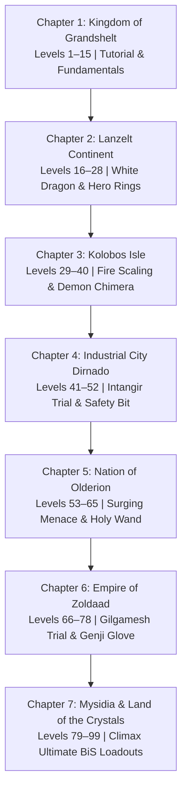

# Final Fantasy Resonance: Chapter-by-Chapter BiS Gear Progression Guide
*Exhaustive Equipment, 4-Accessory Builds, 0-AP Ability Loadouts & Exact Acquisition Locations*

> [!NOTE]
> This guide is tailored specifically to your active modded setup:
> 1. **4 Accessory Slots Enabled (`Equip 4 Accessories`)**: Every character build provides a fully optimized 4-slot accessory configuration.
> 2. **0 AP Unlimited Abilities (`Free AP Ability Permanent`)**: High-tier, multi-hit, and tier-4 (-ja) abilities are slotted immediately as available.
> 3. **100% Item Drop & Steal Rate (`Enemies Drop 100 Percent Item` / `Steal always 100`)**: Boss and trial equipment drops are guaranteed on first clear; theft targets are 100% reliable.
> 4. **Enhanced Limit Burst (`LimitBurst Enhanced JULINOS`)**: High-speed LB gauge acceleration for burst DPS phases.
> 5. **Highlighter Engine Recognition (`highlighter.lua`)**: All items listed below are pre-registered in your UI mod and will highlight with **`★ [BiS]`** or **`▲ [Recommended]`** when inspecting inventory.

---

## 🛠️ Global Mod Synergies & 4-Accessory Slot Archetypes

Because the **Equip 4 Accessories** mod gives you 4 accessory slots instead of 2, stat and passive scaling is exponentially stronger:

| Archetype | Slot 1: Essential Survival | Slot 2: Multiplicative Passive | Slot 3: Primary Stat Multiplier | Slot 4: Flat Stat / Secondary Multiplier |
| :--- | :--- | :--- | :--- | :--- |
| **Sentinel Tank (Rain)** | **Safety Bit** *(Immunity to Instant-Death)* | **Protect Ring** *(Auto-Protect / DEF +10%)* | **Titan's Bangle** *(HP +20%, DEF +30)* | **Phalanx Bangle** / **Muscle Belt** *(HP +10-15%)* |
| **Physical Katana DPS (Lasswell)** | **Ribbon** *(Immunity to All Status)* | **Genji Glove** *(Innate Dual-Wield)* | **Celestial Glove** / **Hero Ring** *(ATK +10-15%)* | **Hero Ring** / **Hyper Wrist** *(ATK +10% / Flat ATK)* |
| **Divine White Mage (Fina)** | **Ribbon** *(Immunity to All Status)* | **Angel Earrings** *(Auto-Regen, SPR +20%)* | **Rosary** *(SPR +15%, MP +10%)* | **Fairy Ring** *(Confusion/Petrify Immune, SPR +10%)* |
| **Omni Black Mage (Sakura / Archwitch Fina)** | **Ribbon** *(Immunity to All Status)* | **Magistral Crest** *(MAG +30%, SPR +30%)* | **Earrings** *(MAG +20%)* | **Earrings** *(MAG +20%)* |
| **Synergist Buffer (Nichol)** | **Sprint Shoes** *(Auto-Haste)* | **Hermes Sandals** *(Agility / Turn Priority)* | **Barrier Ring** *(Auto-Shell / SPR +10%)* | **Gold Ring** *(DEF +10, SPR +10)* |
| **Heavy Breaker (Lid / Jake)** | **Safety Bit** *(Immunity to Instant-Death)* | **Champion's Belt** *(ATK +20%, DEF +20%)* | **Champion's Belt** *(ATK +20%, DEF +20%)* | **Hyper Wrist** / **Desch's Earring** *(Flat ATK)* |

---

## 🗺️ Progression Map

---

## 🛡️ Chapter 1: Kingdom of Grandshelt (Levels 1–15)
*Theme: Early game stabilization, establishing frontline enmity, and reliable party healing.*

### Character BiS Configurations

#### 1. Rain (Frontline Vanguard Tank)
* **Weapon:** **Crimson Saber** *(Innate Fire Greatsword)* or **Broadsword** ($+15 \text{ ATK}$)
* **Body Armor:** **Blessed Cuirass** ($+18 \text{ DEF}$)
* **Shield:** **Buckler** ($+8 \text{ DEF}$)
* **Headgear:** **Leather Cap** ($+3 \text{ DEF}$)
* **Accessories (4 Slots):**
  1. **Bulletproof Vest** ($+10 \text{ DEF}$)
  2. **Bronze Bangle** ($+50 \text{ Max HP}$)
  3. **Earrings of Health** ($+5\% \text{ Max HP}$)
  4. **Power Wrist** ($+5 \text{ ATK}$)
* **0 AP Abilities to Prioritize:** `Shining Splendor`, `Power Break`, `Fire`, `Provoke`
* **Vision Card:** **Warrior of Light** / **Cecil**

#### 2. Lasswell (Critical Katana Breaker)
* **Weapon:** **Shiden** ($+24 \text{ ATK}$, Critical Rate $+5\%$) or **Kotetsu** ($+16 \text{ ATK}$)
* **Body Armor:** **Kenpogi** ($+10 \text{ DEF}$, $+2 \text{ ATK}$)
* **Headgear:** **Bandana** ($+4 \text{ DEF}$)
* **Accessories (4 Slots):**
  1. **Hyper Wrist** ($+15 \text{ ATK}$)
  2. **Power Wrist** ($+5 \text{ ATK}$)
  3. **Protect Ring** ($+5 \text{ DEF}$)
  4. **Battle Boots** ($+5 \text{ DEF}$, $+50 \text{ HP}$)
* **0 AP Abilities to Prioritize:** `Exorcising Blade`, `Armor Break`, `Blizzard`, `Ice Blade`
* **Vision Card:** **Cloud** / **Noctis**

#### 3. Fina (Medic & Luminary Support)
* **Weapon:** **Wooden Staff** ($+10 \text{ ATK}$, $+12 \text{ SPR}$)
* **Body Armor:** **Cotton Robe** ($+8 \text{ DEF}$, $+10 \text{ SPR}$)
* **Headgear:** **Pointed Hat** ($+5 \text{ DEF}$, $+5 \text{ MAG}$)
* **Accessories (4 Slots):**
  1. **Rosary** ($+10 \text{ SPR}$)
  2. **Angel Earrings** ($+10 \text{ SPR}$, Auto-Regen)
  3. **Star Pendant** *(100% Poison Immunity)*
  4. **Bronze Bangle** ($+50 \text{ Max HP}$)
* **0 AP Abilities to Prioritize:** `Cura`, `Esuna`, `Cheer` ($+40\% \text{ ATK/DEF}$ buff), `Banish`
* **Vision Card:** **Ayaka** / **Leah**

### 📍 Chapter 1 Acquisition Locations & Hidden Vaults
* **Blessed Cuirass:** Earth Shrine Exploration — hidden pathway behind the northwest waterfall (Secret Chest #2).
* **Hyper Wrist:** Royal Capital Grandshelt Vault — unlock Vault Key #1 via Grandshelt Sewers quest.
* **Star Pendant:** Mitra Town Armory side-shop (Star Quartz vendor or early quest reward).
* **Shiden:** Story progress reward upon clearing Grandshelt Castle throne room.

---

## ❄️ Chapter 2: Lanzelt Continent (Levels 16–28)
*Theme: Farplane Trials begin, White Dragon unlocks Murasame, and the first crafting multipliers appear.*

### Character BiS Configurations

#### 1. Rain (Heavy Sentinel Tank)
* **Weapon:** **Mythril Blade** ($+38 \text{ ATK}$) / **Iron Blade**
* **Body Armor:** **Iron Armor** ($+24 \text{ DEF}$) / **Steel Armor** ($+28 \text{ DEF}$)
* **Shield:** **Iron Shield** ($+16 \text{ DEF}$)
* **Headgear:** **Iron Helm** ($+12 \text{ DEF}$)
* **Accessories (4 Slots):**
  1. **Bulletproof Vest** ($+10 \text{ DEF}$)
  2. **Muscle Belt** ($+10\% \text{ Max HP}$)
  3. **Barrier Ring** ($+5 \text{ SPR}$, Auto-Shell)
  4. **Protect Ring** ($+5 \text{ DEF}$, Auto-Protect)
* **0 AP Abilities to Prioritize:** `Full Break` (if unlocked), `Lava Floor`, `Provoke`, `Fira`
* **Vision Card:** **Charlotte** / **Golem**

#### 2. Lasswell (Single-Target Finisher)
* **Weapon:** **Murasame** ($+61 \text{ ATK}$, Critical Rate $+10\%$) — *Farplane Trial Reward*
* **Body Armor:** **Black Gi** ($+18 \text{ DEF}$, $+5 \text{ ATK}$)
* **Headgear:** **Tiger Mask** ($+14 \text{ DEF}$, $+14 \text{ ATK}$)
* **Accessories (4 Slots):**
  1. **Hero Ring** ($+10\% \text{ ATK}$, $+10\% \text{ MAG}$)
  2. **Hero Ring** ($+10\% \text{ ATK}$, $+10\% \text{ MAG}$)
  3. **Hyper Wrist** ($+15 \text{ ATK}$)
  4. **Black Belt** ($+15 \text{ DEF}$, $+50\% \text{ Counterattack}$ chance)
* **0 AP Abilities to Prioritize:** `Blizzaga`, `Murasame Mastery`, `Fingersnap`, `Dispel`
* **Vision Card:** **Sephiroth** / **Cloud**

#### 3. Fina (Dedicated Curative Specialist)
* **Weapon:** **Staff of Wrath** ($+18 \text{ ATK}$, $+25 \text{ SPR}$)
* **Body Armor:** **Mage's Habit** ($+14 \text{ DEF}$, $+18 \text{ SPR}$)
* **Headgear:** **Priest's Miter** ($+10 \text{ DEF}$, $+15 \text{ SPR}$)
* **Accessories (4 Slots):**
  1. **Rosary** ($+10 \text{ SPR}$)
  2. **Angel Earrings** ($+10 \text{ SPR}$, Auto-Regen)
  3. **Fairy Ring** *(Confusion & Poison Immunity)*
  4. **Star Pendant** *(Poison Immunity)*
* **0 AP Abilities to Prioritize:** `Curaja` (via 0 AP mod), `Cheer`, `Raise`, `Banishga`
* **Vision Card:** **Ayaka** / **Rosa**

### 📍 Chapter 2 Acquisition Locations & Hidden Vaults
* **Murasame (Farplane Trial - White Dragon):** Enter the Farplane via Earth Shrine exit obelisk. Defeat the White Dragon (vulnerable to Paralyze/Bio). The 100% drop mod guarantees Murasame on turn 1.
* **Hero Ring Recipe:** Grandport Town — complete the quest line "The Way to Greatness" in the merchant quarter. Crafted using 3x Fire Megacrysts + 3x Ice Megacrysts (farmable in Lanzelt Ruins Exploration).
* **Tiger Mask Recipe:** Grandport Armory chest behind the shipyard crates.
* **Staff of Wrath:** Colosseum Intermediate Rank C-1 completion reward.
* **Black Gi:** Lanzelt Ruins Exploration — chest in the southern secret tunnel.

---

## 💀 Chapter 3: Kolobos Isle (Levels 29–40)
*Theme: Elemental exploitation, undead eradication, fire resistances, and Demon Chimera Trial.*

### Character BiS Configurations

#### 1. Rain (Hybrid Fire Tank)
* **Weapon:** **Flametongue** ($+48 \text{ ATK}$, Innate Fire Element)
* **Body Armor:** **Flame Mail** ($+35 \text{ DEF}$, $+50\% \text{ Fire Resist}$, $-50\% \text{ Ice Resist}$)
* **Shield:** **Flame Shield** ($+28 \text{ DEF}$, $+50\% \text{ Fire Resist}$) or **Force Shield** ($+40 \text{ DEF}$, $+10\% \text{ All Resist}$)
* **Headgear:** **Mythril Helm** ($+18 \text{ DEF}$)
* **Accessories (4 Slots):**
  1. **Titan's Bangle** ($+20\% \text{ HP}$, $+30 \text{ DEF}$)
  2. **Muscle Belt** ($+10\% \text{ Max HP}$)
  3. **Bulletproof Vest** ($+10 \text{ DEF}$)
  4. **Barrier Ring** ($+5 \text{ SPR}$, Auto-Shell)
* **0 AP Abilities to Prioritize:** `Undead Killer`, `Firaga`, `Lava Floor`, `Multi-Cover`
* **Vision Card:** **Wilhelm** / **Golem**

#### 2. Lasswell (Elemental Katana Striker)
* **Weapon:** **Murasame** ($+61 \text{ ATK}$) or **Osafune** ($+42 \text{ ATK}$)
* **Body Armor:** **Shinobi Gear** ($+24 \text{ DEF}$, $+5\% \text{ Evasion}$)
* **Headgear:** **Tiger Mask** ($+14 \text{ DEF}$, $+14 \text{ ATK}$)
* **Accessories (4 Slots):**
  1. **Hero Ring** ($+10\% \text{ ATK}$)
  2. **Hero Ring** ($+10\% \text{ ATK}$)
  3. **Hyper Wrist** ($+15 \text{ ATK}$)
  4. **Black Belt** ($+15 \text{ DEF}$, Counter)
* **0 AP Abilities to Prioritize:** `Ice Flash`, `Blizzaga`, `Murasame Critical Slice`, `Full Break`
* **Vision Card:** **Sephiroth** / **Tidus**

#### 3. Fina (Status Warden)
* **Weapon:** **Rune Staff** ($+22 \text{ ATK}$, $+32 \text{ SPR}$)
* **Body Armor:** **White Robe** ($+20 \text{ DEF}$, $+25 \text{ SPR}$)
* **Headgear:** **Priest's Miter** ($+10 \text{ DEF}$, $+15 \text{ SPR}$)
* **Accessories (4 Slots):**
  1. **Rosary** ($+10 \text{ SPR}$)
  2. **Fairy Ring** *(Confusion & Poison Immune)*
  3. **Angel Earrings** ($+10 \text{ SPR}$, Auto-Regen)
  4. **Jeweled Ring** *(Stone & Paralyze Immune)*
* **0 AP Abilities to Prioritize:** `Curaja`, `Esunaga`, `Dualcast White Magic`, `Cheer`
* **Vision Card:** **Ayaka** / **Aerith**

### 📍 Chapter 3 Acquisition Locations & Hidden Vaults
* **Flametongue:** Shrine of Decay Exploration — northeast room hidden behind a destructible rubble wall.
* **Flame Mail & Flame Shield:** Kolobos Marsh Exploration — Chest #4 (near the venom lake exit) and Felicitas Town Armory.
* **Force Shield (Farplane Trial - Demon Chimera):** Defeat Demon Chimera in the Farplane. Grants $+40 \text{ DEF}$ and widespread elemental reduction.
* **Jeweled Ring:** Felicitas Town — completed from the quest "A Mother's Keepsake". Complete immunity to Stone & Paralyze.

---

## ⚙️ Chapter 4: Industrial City Dirnado (Levels 41–52)
*Theme: Lid joins the active squad; machine-slayer equipment; Intangir Trial unlocks Enhancer.*

### Character BiS Configurations

#### 1. Rain (Hybrid Magic/Physical Tank)
* **Weapon:** **Enhancer** ($+82 \text{ ATK}$, $+23 \text{ MAG}$) — *Intangir Trial Reward*
* **Body Armor:** **Gold Armor** ($+42 \text{ DEF}$)
* **Shield:** **Knight's Shield** ($+32 \text{ DEF}$)
* **Headgear:** **Gold Helm** ($+22 \text{ DEF}$)
* **Accessories (4 Slots):**
  1. **Safety Bit** *(Complete Immunity to Instant Death)* — *Crucial for Bosses*
  2. **Titan's Bangle** ($+20\% \text{ HP}$, $+30 \text{ DEF}$)
  3. **Muscle Belt** ($+10\% \text{ HP}$)
  4. **Protect Ring** ($+5 \text{ DEF}$, Auto-Protect)
* **0 AP Abilities to Prioritize:** `Full Break`, `Fire Slash`, `Cover All`, `Firaja`
* **Vision Card:** **Golem** / **Warrior of Light**

#### 2. Lasswell (Armor Piercing Duelist)
* **Weapon:** **Kiku-ichimonji** ($+87 \text{ ATK}$) or **Murasame** ($+61 \text{ ATK}$)
* **Body Armor:** **Brave Suit** ($+30 \text{ DEF}$, $+15\% \text{ ATK/MAG}$) / **Black Gi**
* **Headgear:** **Tiger Mask** ($+14 \text{ DEF}$, $+14 \text{ ATK}$)
* **Accessories (4 Slots):**
  1. **Hero Ring** ($+10\% \text{ ATK}$)
  2. **Hero Ring** ($+10\% \text{ ATK}$)
  3. **Hero Ring** ($+10\% \text{ ATK}$)
  4. **Hyper Wrist** ($+15 \text{ ATK}$)
* **0 AP Abilities to Prioritize:** `Oblivion`, `Blizzaja`, `Armor Eraser`, `Critical Stance`
* **Vision Card:** **Cloud** / **Sephiroth**

#### 3. Fina (High Priestess)
* **Weapon:** **Golden Staff** ($+28 \text{ ATK}$, $+40 \text{ SPR}$)
* **Body Armor:** **Minerva Bustier** ($+47 \text{ DEF}$, $+45 \text{ SPR}$, $+30\% \text{ Elemental Resist}$) / **White Robe**
* **Headgear:** **Priest's Miter** ($+10 \text{ DEF}$, $+15 \text{ SPR}$)
* **Accessories (4 Slots):**
  1. **Rosary** ($+10 \text{ SPR}$)
  2. **Fairy Ring** *(Confusion & Poison Immune)*
  3. **Jeweled Ring** *(Stone & Paralyze Immune)*
  4. **Angel Earrings** ($+10 \text{ SPR}$)
* **0 AP Abilities to Prioritize:** `Curaja`, `Full-Life`, `Reraise`, `Curaja Dualcast`
* **Vision Card:** **Ayaka** / **Garnet**

#### 4. Lid (Mechanist & Boss Stat Demolisher)
* **Weapon:** **Battle Hammer** ($+55 \text{ ATK}$) / **Heavy Wrench**
* **Body Armor:** **Mechanic Overalls** ($+28 \text{ DEF}$, $+10\% \text{ Machine Killer}$)
* **Headgear:** **Miner's Helmet** ($+12 \text{ DEF}$, $+10\% \text{ Stagger Power}$)
* **Accessories (4 Slots):**
  1. **Muscle Belt** ($+10\% \text{ HP}$)
  2. **Titan's Bangle** ($+20\% \text{ HP}$, $+30 \text{ DEF}$)
  3. **Hyper Wrist** ($+15 \text{ ATK}$)
  4. **Power Belt** ($+10 \text{ ATK}$, $+5 \text{ DEF}$)
* **0 AP Abilities to Prioritize:** `Armor Break EX`, `Weapon Break EX`, `Analyze / Libra`, `Machine Buster`
* **Vision Card:** **Tidus** / **Camille**

### 📍 Chapter 4 Acquisition Locations & Hidden Vaults
* **Safety Bit:** Dilmagia Star Quartz Trader (Fat Chocobo shop) — Costs 50 Star Quartz. *Mandatory tank accessory: prevents instant death.*
* **Enhancer (Farplane Trial - Intangir):** Defeat the sleeping giant Intangir in the Farplane. Guaranteed 100% weapon drop.
* **Kiku-ichimonji:** Wind Shrine Exploration — hidden room in the northwest quadrant behind the ventilation pipes.
* **Minerva Bustier:** Dilmagia Vault Key #10 reward (unlocked via Dilmagia underground quest line).

---

## 🌊 Chapter 5: Nation of Olderion (Levels 53–65)
*Theme: Nichol and Sakura join; Wizard's Rod, Antenolla Trial, and heavy Magic/Spirit scaling.*

### Character BiS Configurations

#### 1. Rain (Omni-Elemental Bastion)
* **Weapon:** **Enhancer** ($+82 \text{ ATK}$, $+23 \text{ MAG}$)
* **Body Armor:** **Diamond Armor** ($+55 \text{ DEF}$)
* **Shield:** **Ice Shield** ($+35 \text{ DEF}$, $+50\% \text{ Ice Resist}$) / **Force Shield**
* **Headgear:** **Diamond Helm** ($+25 \text{ DEF}$)
* **Accessories (4 Slots):**
  1. **Safety Bit** *(Instant-Death Immune)*
  2. **Titan's Bangle** ($+20\% \text{ HP}$, $+30 \text{ DEF}$)
  3. **Protect Ring** ($+10 \text{ DEF}$, Auto-Protect)
  4. **Muscle Belt** ($+10\% \text{ HP}$)
* **0 AP Abilities to Prioritize:** `Full Break`, `Leadership`, `Sentinel Bastion`, `Firaja`
* **Vision Card:** **Wilhelm** / **Alexander**

#### 2. Lasswell (Glacial Blade Master)
* **Weapon:** **Icebrand** ($+68 \text{ ATK}$, Innate Ice) or **Kiku-ichimonji** ($+87 \text{ ATK}$)
* **Body Armor:** **Brave Suit** ($+30 \text{ DEF}$, $+15\% \text{ ATK/MAG}$)
* **Headgear:** **Tiger Mask** ($+14 \text{ DEF}$, $+14 \text{ ATK}$)
* **Accessories (4 Slots):**
  1. **Hero Ring** ($+10\% \text{ ATK}$)
  2. **Hero Ring** ($+10\% \text{ ATK}$)
  3. **Hero Ring** ($+10\% \text{ ATK}$)
  4. **Hero Ring** ($+10\% \text{ ATK}$)
* **0 AP Abilities to Prioritize:** `Blizzaja`, `Icicle Edge`, `Mirror of Equity`, `Armor Eraser`
* **Vision Card:** **Sephiroth** / **Noctis**

#### 3. Fina (Divine Luminary)
* **Weapon:** **Holy Wand** ($+12 \text{ ATK}$, $+120 \text{ SPR}$, Innate Dualcast White Magic) — *White Witch Trial*
* **Body Armor:** **Minerva Bustier** ($+47 \text{ DEF}$, $+45 \text{ SPR}$, $+30\% \text{ Elemental Resist}$)
* **Headgear:** **Gold Hairpin** ($+12 \text{ DEF}$, $+15 \text{ MAG/SPR}$)
* **Accessories (4 Slots):**
  1. **Ribbon** *(Complete Immunity to All 8 Status Ailments)*
  2. **Angel Earrings** ($+10 \text{ SPR}$, Auto-Regen)
  3. **Rosary** ($+10 \text{ SPR}$)
  4. **Fairy Ring** *(Confusion Immune)*
* **0 AP Abilities to Prioritize:** `Curaja Dualcast`, `Full-Life`, `Reraise`, `Supreme Blessing`
* **Vision Card:** **Ayaka** / **Aerith**

#### 4. Sakura (Omni-Sage Magical Artillery)
* **Weapon:** **Wizard's Rod** ($+18 \text{ ATK}$, $+72 \text{ MAG}$) — *Surging Menace Trial*
* **Body Armor:** **Black Robe** ($+25 \text{ DEF}$, $+20 \text{ MAG}$)
* **Headgear:** **Mage's Hat** ($+10 \text{ DEF}$, $+15 \text{ MAG}$)
* **Accessories (4 Slots):**
  1. **Earrings** ($+20\% \text{ MAG}$, $+3 \text{ DEF}$)
  2. **Earrings** ($+20\% \text{ MAG}$, $+3 \text{ DEF}$)
  3. **Hero Ring** ($+10\% \text{ MAG}$)
  4. **Hero Ring** ($+10\% \text{ MAG}$)
* **0 AP Abilities to Prioritize:** `Thundaja`, `Rebel Fire`, `Quick Dualcast`, `Thunder's Light`
* **Vision Card:** **Terra** / **Clive**

#### 5. Nichol (High Tactician & Turn Manipulator)
* **Weapon:** **Platinum Staff** ($+30 \text{ ATK}$, $+45 \text{ SPR}$) / **Scholar's Book**
* **Body Armor:** **Scholar's Robe** ($+22 \text{ DEF}$, $+30 \text{ SPR}$, $+10\% \text{ MP}$)
* **Headgear:** **Circlet** ($+10 \text{ DEF}$, $+15 \text{ MAG/SPR}$)
* **Accessories (4 Slots):**
  1. **Sprint Shoes** *(Auto-Haste)*
  2. **Hermes Sandals** *(Turn Agility Bonus)*
  3. **Barrier Ring** ($+5 \text{ SPR}$, Auto-Shell)
  4. **Gold Ring** ($+10 \text{ DEF}$, $+10 \text{ SPR}$)
* **0 AP Abilities to Prioritize:** `Courageous Stance` ($+100\% \text{ ATK/MAG}$ buff), `Soul of Water`, `Impenetrable Stance` ($+100\% \text{ DEF/SPR}$ buff)
* **Vision Card:** **Victoria** / **Tronn**

#### 6. Lid (Demolitionist)
* **Weapon:** **Thorned Mace** ($+78 \text{ ATK}$, Poison Touch) — *Antenolla Trial*
* **Body Armor:** **Grand Armor** ($+72 \text{ DEF}$) / **Mechanic Overalls**
* **Headgear:** **Tiger Mask** ($+14 \text{ ATK}$)
* **Accessories (4 Slots):**
  1. **Champion's Belt** ($+20\% \text{ ATK}$, $+20\% \text{ DEF}$)
  2. **Titan's Bangle** ($+20\% \text{ HP}$, $+30 \text{ DEF}$)
  3. **Hyper Wrist** ($+15 \text{ ATK}$)
  4. **Muscle Belt** ($+10\% \text{ HP}$)
* **0 AP Abilities to Prioritize:** `Full Break EX`, `Weapon Break EX`, `Shield Smash`
* **Vision Card:** **Tidus**

### 📍 Chapter 5 Acquisition Locations & Hidden Vaults
* **Earrings (+20% MAG):** Olderion Federation Star Quartz Trader (Fat Chocobo) — 50 Star Quartz each. Buy 2 for Sakura.
* **Wizard's Rod (Surging Menace Trial):** Farplane multi-boss chamber. 100% drop on clear.
* **Holy Wand (White Witch Trial):** Farplane White Witch encounter. Yields innate Dualcast White Magic.
* **Thorned Mace (Antenolla Trial):** Farplane plant trial. Yields $+78 \text{ ATK}$ and Plant Killer trait.
* **Sprint Shoes:** Aquapolis Olderion Vault Key #14 reward.

---

## 🔥 Chapter 6: Empire of Zoldaad (Levels 66–78)
*Theme: Jake joins the squad; Gilgamesh Trial unlocks Genji Glove (Innate Dual-Wield); Ribbon acquired.*

### Character BiS Configurations

#### 1. Rain (Vanguard Fortress)
* **Weapon:** **Excalibur** ($+120 \text{ ATK}$, Innate Light) or **Save the Queen** ($+112 \text{ ATK}$, $+20\% \text{ HP}$)
* **Body Armor:** **Dragon Mail** ($+45 \text{ DEF}$, $+30\% \text{ Fire/Ice/Lightning Resist}$)
* **Shield:** **Genji Shield** ($+50 \text{ DEF}$, $+25 \text{ SPR}$, Death Immune) / **Flame Shield**
* **Headgear:** **Grand Helm** ($+45 \text{ DEF}$, Heavy Armor Mastery $+20\% \text{ DEF}$)
* **Accessories (4 Slots):**
  1. **Safety Bit** *(Instant Death Immunity)*
  2. **Protect Ring** ($+10 \text{ DEF}$, Auto-Protect)
  3. **Titan's Bangle** ($+20\% \text{ HP}$, $+30 \text{ DEF}$)
  4. **Phalanx Bangle** ($+15\% \text{ HP}$, $+15 \text{ DEF}$)
* **0 AP Abilities to Prioritize:** `Complete Cover`, `Undying Will`, `Full Break`, `Firaja Strike`
* **Vision Card:** **Wilhelm** / **Basch**

#### 2. Lasswell (Legendary Dual-Wielder)
* **Weapon 1 (Main Hand):** **Masamune** ($+150 \text{ ATK}$, Critical Rate $+15\%$)
* **Weapon 2 (Off Hand):** **Chirijiraden** ($+80 \text{ ATK}$, Innate Fire) or **Zanmato** ($+95 \text{ ATK}$)
* **Body Armor:** **Brave Suit** ($+30 \text{ DEF}$, $+15\% \text{ ATK/MAG}$)
* **Headgear:** **Tiger Mask** or **Black Cowl** ($+28 \text{ ATK}$, $+25 \text{ DEF}$)
* **Accessories (4 Slots):**
  1. **Genji Glove** *(Innate Dual-Wield +10% ATK/MAG)* — *Gilgamesh Trial*
  2. **Hero Ring** ($+10\% \text{ ATK}$)
  3. **Hero Ring** ($+10\% \text{ ATK}$)
  4. **Hero Ring** ($+10\% \text{ ATK}$)
* **0 AP Abilities to Prioritize:** `Dual Blade Sever`, `Oblivion Blade`, `Blizzaja Edge`, `Armor Break EX`
* **Vision Card:** **Sephiroth** / **Cloud**

#### 3. Fina (Divine Luminary Warden)
* **Weapon:** **Holy Wand** ($+120 \text{ SPR}$, Innate Dualcast)
* **Body Armor:** **Minerva Bustier** ($+47 \text{ DEF}$, $+45 \text{ SPR}$, $+30\% \text{ All Resist}$)
* **Headgear:** **Gold Hairpin** ($+12 \text{ DEF}$, $+15 \text{ MAG/SPR}$)
* **Accessories (4 Slots):**
  1. **Ribbon** *(Complete Immunity to All 8 Status Ailments)*
  2. **Angel Earrings** ($+10 \text{ SPR}$, Auto-Regen)
  3. **Rosary** ($+10 \text{ SPR}$)
  4. **Fairy Ring** ($+10 \text{ SPR}$)
* **0 AP Abilities to Prioritize:** `Curaja Dualcast`, `Full-Life`, `Reraise`, `Supreme Blessing`
* **Vision Card:** **Ayaka** / **Aerith**

#### 4. Jake (Corsair Sniper & Long-Range Chainer)
* **Weapon 1:** **Romandan Pistol** ($+107 \text{ ATK}$)
* **Weapon 2:** **Silver Rifle** / **Mythril Gun** ($+60 \text{ ATK}$)
* **Body Armor:** **Corsair Coat** ($+34 \text{ DEF}$, $+15 \text{ ATK}$)
* **Headgear:** **Tiger Mask** ($+14 \text{ ATK}$)
* **Accessories (4 Slots):**
  1. **Desch's Earring** ($+45 \text{ ATK}$) / **Hyper Wrist**
  2. **Hyper Wrist** ($+15 \text{ ATK}$)
  3. **Hero Ring** ($+10\% \text{ ATK}$)
  4. **Hero Ring** ($+10\% \text{ ATK}$)
* **0 AP Abilities to Prioritize:** `Arms Akimbo Dual-Wield`, `Rapid Shot EX`, `Break Shot`, `Fatal Bullet`
* **Vision Card:** **Amelia** / **Vincent**

#### 5. Sakura (Lightning Primarch)
* **Weapon:** **Wizard's Rod** ($+72 \text{ MAG}$)
* **Body Armor:** **Black Robe** ($+20 \text{ MAG}$)
* **Headgear:** **Circlet** ($+15 \text{ MAG}$)
* **Accessories (4 Slots):**
  1. **Earrings** ($+20\% \text{ MAG}$)
  2. **Earrings** ($+20\% \text{ MAG}$)
  3. **Hero Ring** ($+10\% \text{ MAG}$)
  4. **Hero Ring** ($+10\% \text{ MAG}$)
* **0 AP Abilities to Prioritize:** `Quick Dualcast Thundaja`, `Rebel Fireja`, `Thunder's Light`
* **Vision Card:** **Terra** / **Clive**

#### 6. Lid (Titan Breaker)
* **Weapon:** **Gigantaxe** ($+92 \text{ ATK}$) / **Thorned Mace**
* **Body Armor:** **Grand Armor** ($+72 \text{ DEF}$)
* **Headgear:** **Tiger Mask** ($+14 \text{ ATK}$)
* **Accessories (4 Slots):**
  1. **Champion's Belt** ($+20\% \text{ ATK}$, $+20\% \text{ DEF}$)
  2. **Champion's Belt** ($+20\% \text{ ATK}$, $+20\% \text{ DEF}$)
  3. **Titan's Bangle** ($+20\% \text{ HP}$, $+30 \text{ DEF}$)
  4. **Muscle Belt** ($+10\% \text{ HP}$)
* **0 AP Abilities to Prioritize:** `Mega Armor Break`, `Mega Weapon Break`, `Shield Demolisher`
* **Vision Card:** **Tidus**

### 📍 Chapter 6 Acquisition Locations & Hidden Vaults
* **Genji Glove & Masamune (Gilgamesh Trial):** Battle on the Big Bridge in the Farplane. Guaranteed drop of Genji Glove and Masamune blade.
* **Ribbon:** Royal Capital Zoldaad Vault Key #20 master reward. *Grants complete status ailment immunity.*
* **Chirijiraden:** Fire Shrine Exploration — secret inner sanctum chest (behind flaming seal).
* **Dragon Mail:** Zoldaad Castle Armory — chest in the western guard barracks.
* **Romandan Pistol:** Invincible Interior Exploration — engine room secret catwalk chest.

---

## ⚡ Chapter 7: Mysidia & Land of the Crystals (Levels 79–99)
*Theme: Endgame climax; Archwitch Fina unlocked; Tower Trials; Ultimate Best-in-Slot loadouts.*

### Ultimate BiS Configurations by Character

#### 1. Rain (The Unbreakable Bastion)
* **Weapon:** **Ultima Weapon** ($+180 \text{ ATK}$, $+15\% \text{ HP}$) or **Excalibur II** ($+130 \text{ ATK}$)
* **Body Armor:** **Maximilian** ($+62 \text{ DEF}$)
* **Shield:** **Genji Shield** ($+50 \text{ DEF}$, $+25 \text{ SPR}$, Death Immune)
* **Headgear:** **Grand Helm** ($+45 \text{ DEF}$, $+20\% \text{ DEF with Heavy Armor}$)
* **Accessories (4 Slots):**
  1. **Safety Bit** *(Death Immunity)*
  2. **Phalanx Bangle** ($+15\% \text{ HP}$, $+15 \text{ DEF}$)
  3. **Titan's Bangle** ($+20\% \text{ HP}$, $+30 \text{ DEF}$)
  4. **Protect Ring** ($+10 \text{ DEF}$, Auto-Protect)
* **0 AP Abilities to Prioritize:** `Invincible Wall`, `Shining Saber EX`, `Full Break Mastery`, `Undying Flame`
* **Signature Vision:** **Wilhelm** / **Alexander**

#### 2. Lasswell (Legendary Crimson Blade)
* **Weapon 1 (Main Hand):** **Masamune** ($+150 \text{ ATK}$, $+15\% \text{ Crit}$)
* **Weapon 2 (Off Hand):** **Chirijiraden** ($+80 \text{ ATK}$, Fire) or **Zanmato** ($+95 \text{ ATK}$)
* **Body Armor:** **Brave Suit** ($+30 \text{ DEF}$, $+15\% \text{ ATK/MAG}$)
* **Headgear:** **Black Cowl** ($+28 \text{ ATK}$, $+25 \text{ DEF}$, Sleep Immune)
* **Accessories (4 Slots):**
  1. **Genji Glove** *(Innate Dual-Wield, +10% ATK)*
  2. **Celestial Glove** ($+30 \text{ All Stats}$)
  3. **Hero Ring** ($+10\% \text{ ATK}$)
  4. **Hero Ring** ($+10\% \text{ ATK}$)
* **0 AP Abilities to Prioritize:** `True Mirror of Equity`, `Oblivion Blade Zero`, `Blizzaja Tempest`, `Dispel Blade`
* **Signature Vision:** **Sephiroth**

#### 3. Fina (High Cherub Healer)
* **Weapon:** **Nirvana** ($+19 \text{ ATK}$, $+130 \text{ SPR}$, $+20\% \text{ MP}$) or **Holy Wand**
* **Body Armor:** **Rainbow Robe** ($+45 \text{ DEF}$, $+45 \text{ MAG/SPR}$, $+45\% \text{ All Resist}$)
* **Headgear:** **Gold Hairpin** ($+12 \text{ DEF}$, $+15 \text{ SPR}$)
* **Accessories (4 Slots):**
  1. **Ribbon** *(Complete Status Immunity)*
  2. **Angel Earrings** ($+10 \text{ SPR}$, Auto-Regen)
  3. **Rosary** ($+10 \text{ SPR}$)
  4. **Fairy Ring** ($+10 \text{ SPR}$)
* **0 AP Abilities to Prioritize:** `Curaja Dualcast`, `Reraise All`, `Full-Life All`, `Supreme Blessing`
* **Signature Vision:** **Ayaka**

#### 4. Archwitch Fina (Chaos Saboteur & Dark Sovereign)
* **Weapon:** **Omnirod** ($+91 \text{ MAG}$) / **Stardust Rod** ($+85 \text{ MAG}$)
* **Body Armor:** **Lordly Robe** ($+45 \text{ DEF}$, $+35 \text{ MAG/SPR}$) or **Siren's Robe**
* **Headgear:** **Cat-Ear Hood** ($+25 \text{ MAG/SPR}$, $+20\% \text{ Fire/Ice/Lightning/Light Resist}$)
* **Accessories (4 Slots):**
  1. **Magistral Crest** ($+30\% \text{ MAG}$, $+30\% \text{ SPR}$)
  2. **Earrings** ($+20\% \text{ MAG}$)
  3. **Earrings** ($+20\% \text{ MAG}$)
  4. **Earrings** ($+20\% \text{ MAG}$)
* **0 AP Abilities to Prioritize:** `Dystopia EX`, `Darkja Dualcast`, `Ultima Dualcast`, `Boreas Gale`
* **Signature Vision:** **Colossal Shantotto**

#### 5. Sakura (Omni-Sage Arch-Mage)
* **Weapon:** **Omnirod** ($+91 \text{ MAG}$) / **Wizard's Rod** ($+72 \text{ MAG}$)
* **Body Armor:** **Lordly Robe** ($+45 \text{ DEF}$, $+35 \text{ MAG/SPR}$)
* **Headgear:** **Cat-Ear Hood** ($+25 \text{ MAG/SPR}$)
* **Accessories (4 Slots):**
  1. **Magistral Crest** ($+30\% \text{ MAG}$, $+30\% \text{ SPR}$)
  2. **Earrings** ($+20\% \text{ MAG}$)
  3. **Earrings** ($+20\% \text{ MAG}$)
  4. **Earrings** ($+20\% \text{ MAG}$)
* **0 AP Abilities to Prioritize:** `Quick Dualcast Thundaja`, `Rebel Fireja`, `Torrential Gale`, `Thunder Primarch`
* **Signature Vision:** **Terra** / **Clive**

#### 6. Nichol (Grand Sovereign Strategist)
* **Weapon:** **Platinum Staff** ($+45 \text{ SPR}$)
* **Body Armor:** **Siren's Robe** ($+40 \text{ DEF}$, $+40 \text{ MAG/SPR}$, Sleep/Silence Immune)
* **Headgear:** **Circlet** ($+15 \text{ SPR}$)
* **Accessories (4 Slots):**
  1. **Sprint Shoes** *(Auto-Haste)*
  2. **Hermes Sandals** *(Turn Agility)*
  3. **Ribbon** *(Complete Status Immunity)*
  4. **Barrier Ring** ($+5 \text{ SPR}$, Auto-Shell)
* **0 AP Abilities to Prioritize:** `Soul of Water Supreme`, `Courageous Stance`, `Fortune Stance`, `Magic Barrier`
* **Signature Vision:** **Victoria**

#### 7. Lid (Grand Breaker)
* **Weapon:** **Gigantaxe** ($+92 \text{ ATK}$)
* **Body Armor:** **Grand Armor** ($+72 \text{ DEF}$)
* **Headgear:** **Grand Helm** ($+45 \text{ DEF}$)
* **Accessories (4 Slots):**
  1. **Champion's Belt** ($+20\% \text{ ATK}$, $+20\% \text{ DEF}$)
  2. **Champion's Belt** ($+20\% \text{ ATK}$, $+20\% \text{ DEF}$)
  3. **Titan's Bangle** ($+20\% \text{ HP}$, $+30 \text{ DEF}$)
  4. **Muscle Belt** ($+10\% \text{ HP}$)
* **0 AP Abilities to Prioritize:** `Mega Armor Break`, `Mega Weapon Break`, `Shield Demolisher`
* **Signature Vision:** **Tidus**

#### 8. Jake (Deadeye Corsair)
* **Weapon 1:** **Quicksilver** ($+115 \text{ ATK}$)
* **Weapon 2:** **Romandan Pistol** ($+107 \text{ ATK}$)
* **Body Armor:** **Brave Suit** ($+30 \text{ DEF}$, $+15\% \text{ ATK/MAG}$)
* **Headgear:** **Tiger Mask** ($+14 \text{ ATK}$)
* **Accessories (4 Slots):**
  1. **Desch's Earring** ($+45 \text{ ATK}$)
  2. **Hyper Wrist** ($+15 \text{ ATK}$)
  3. **Hyper Wrist** ($+15 \text{ ATK}$)
  4. **Hero Ring** ($+10\% \text{ ATK}$)
* **0 AP Abilities to Prioritize:** `Arms Akimbo Dual-Wield`, `Rapid Shot EX`, `Break Shot Mastery`, `Fatal Bullet`
* **Signature Vision:** **Amelia**

### 📍 Chapter 7 Acquisition Locations & Hidden Vaults
* **Ultima Weapon (Farplane Trial - Echidna):** Guaranteed 100% trial drop.
* **Nirvana (Farplane Trial - 2-Headed Dragon):** Guaranteed 100% trial drop.
* **Omnirod & Lordly Robe:** Land of the Crystals Exploration — Secret vault room reached via crystal warp pad #3.
* **Rainbow Robe & Siren's Robe:** Mysidia Underground Vault Key #30 reward.
* **Cat-Ear Hood:** Mysidia Fat Chocobo Star Quartz Trader — 100 Star Quartz.
* **Magistral Crest & Celestial Glove:** Mysidia Master Vault Key #32 & #35.

---

## 💎 Consumable & Revival Hierarchy (In-Game AI Automation)
Your `FFRAutoBattle` mod engine automatically enforces this sequence when reviving fallen allies:
1. **`Arise` (100% HP Revive Spell)**: Highest priority when caster has turn priority.
2. **`Phoenix Pinion` (100% HP Revive Item)**: Consumable prioritized over standard Raise; restores ally at full HP.
3. **`Raise` (10% HP Revive Spell)**: Fallback spell if Pinions are depleted.
4. **`Phoenix Down` (10% HP Revive Item)**: Emergency last-resort revival.
